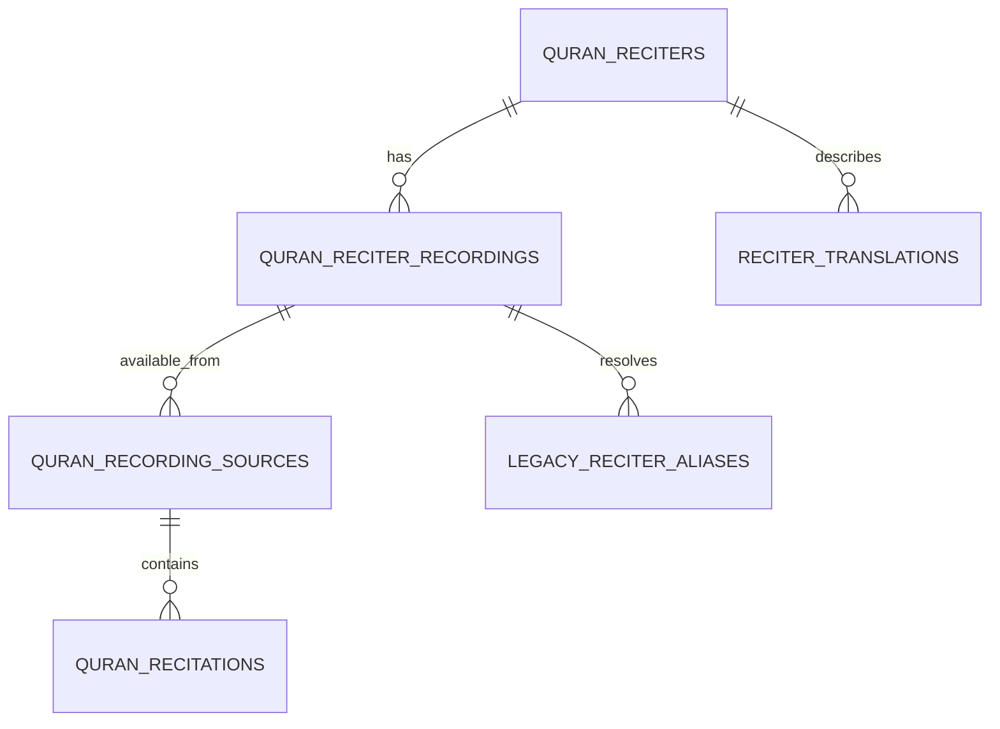

# Separate reciter identity from recording variants

Status: Proposed. This document records the database audit and recommended design; no application or database changes have been applied.

## Observed data

Read-only audit of the configured MySQL database on 2026-09-13:

- 301 rows in `quran_reciters`: 293 recitation entries and 8 translation entries, all active. These are not counts of distinct people.
- 27,371 associated whole-surah audio rows.
- 54 entries have a null style. Do not automatically interpret null as murattal.
- Al-Minshawi: IDs 33, 34, 339, 340; mujawwad, murattal, a separately stored recording with unspecified style, and muallim. ID 339 has 110 surahs; the other three have 114 each.
- Al-Husary: IDs 20, 22, 65, 344, 345, 346; the base Hafs entry, mujawwad, muallim, Qalon, Aldori and Warsh entries.
- Abdul Basit: IDs 2, 3, 9, 62; murattal, mujawwad, a QuranExplorer entry and Warsh.
- Other candidate groups include Maher Al Muaiqly / Maher Al Meaqli, Mustafa Ismail, Muftah Alsaltany, Ahmad Deban and Abdulrasheed Soufi. Name similarity is a review aid, not sufficient evidence for an automatic merge.
- IDs 2 and 9 share `https://server7.mp3quran.net/basit/` and timing read 53, but have different EveryAyah folders. They duplicate the whole-surah source mapping while retaining different per-verse source configurations. Preserve both until those sources are reviewed.

The importer explicitly creates one reciter row per recording. The catalogue adapter already retains the upstream person ID and moshaf ID in memory, but the importer does not persist those two identities separately. The database only stores the audio folder and nullable timing read ID.

## ADR: A person owns multiple recordings

### Decision

Use one canonical reciter identity and multiple recording variants. Keep the current Laravel/MySQL stack. The intended domain model is:

| Entity | Owns |
| --- | --- |
| Reciter | Canonical slug, localized person name and biography, country, portrait, featured status, display order and visibility |
| Recording variant | Reciter ID, style, riwayah, localized recording label, visibility and ordering |
| Recording source | Recording ID, provider key, source kind, external person/recording/timing references, base URL, optional provider metadata, priority, visibility and revision |
| Surah audio | Source ID, surah ID, format, URL, duration, quality and file size; recording and person resolved through the source |
| Legacy alias | Old reciter ID and slug mapped to the exact recording variant |

Style and riwayah remain separate fields: the database contains murattal recordings in several riwayat. Allow more than one recording with the same style and riwayah, distinguished by a recording label/source. A style list in JSON on the person cannot represent this safely.

The surah audio uniqueness constraint should eventually be `(source_id, surah_id, format)`, allowing multiple sources for a recording. It is currently `(reciter_id, surah_id, format)`, so moving existing audio onto one person ID would cause collisions. Current cascade deletion also makes deleting sibling reciters unsafe. If multiple qualities per format are introduced, extend the asset key explicitly rather than overwriting a source's existing file.

Keep recording identity independent of timing availability: persist external recording identity even when no timing reference exists. Existing duplicate source mappings must be resolved before enforcing uniqueness on them.

## ADR: Provider-neutral recording sources

### Decision

Keep provider names as data, not column names. Put integrations behind application adapters and store their references in `quran_recording_sources`. Do not put `mp3quran_*` or `everyayah_*` columns on the canonical person or recording tables.

Suggested source columns:

| Column | Meaning |
| --- | --- |
| `id`, `recording_id` | Internal source identity and parent recording |
| `provider` | Stable adapter key, such as `mp3quran`, `everyayah` or `local`; a string value, not a schema dependency |
| `kind` | Audio layout, initially `surah` or `ayah` |
| `source_key` | Non-null adapter-defined source identity, stable across URL changes |
| `external_reciter_id` | Nullable provider person reference, stored as a string |
| `external_recording_id` | Nullable provider recording reference, stored as a string |
| `external_timing_id` | Nullable timing reference applicable to this source's audio |
| `base_url` | Nullable source root; individual asset URLs can remain absolute |
| `metadata` | Optional JSON for provider-specific details such as folder paths; no credentials |
| `priority`, `is_active`, `revision` | Source preference, availability and cache invalidation version |

Use ordinary indexed columns for identity and selection fields. Reserve JSON for integration details that do not drive relational queries. Namespace external IDs by provider and source kind; do not assume they are numeric or globally unique. For providers without an external ID, use an adapter-defined stable source key for idempotent imports, rather than treating a changeable CDN URL as permanent identity.

Provider adapters translate their catalogue and URL conventions into this structure. The player consumes resolved audio URLs and source-specific timing data through the same application services, without provider conditionals in the UI. A provider registry in application configuration is sufficient initially; a separate provider-management table is unnecessary unless administrators need to manage providers dynamically.

Two sources can belong to one recording only after verifying that they represent the intended recording variant. Equal person, style and riwayah do not prove equal performances. Timings are attached to a specific audio source and revision, never to the person or style. On a source change, discard old timings and do not resume using the old wall-clock offset unless alignment is verified. Alternate ayah files may require their own verse queue and have no usable whole-surah timings.

Changing providers then means adding and validating source rows and configuring an adapter when needed, preserving the internal person/recording IDs. Change source priority only after checking coverage and recording identity. A missing or failed source must not silently switch the listener to another style or riwayah.

### Alternatives and consequences

- Renaming `mp3quran_read_id` to `provider_id` on a recording still limits the recording to one provider and conflates external person, recording and timing identities. Not recommended.
- Putting all source data in JSON on a recording avoids new columns but weakens indexing, ownership and source-level audio/timing relationships. Not recommended.
- A source child table adds a join and adapter maintenance, while supporting the two providers already used by this application and future replacements without vendor-named schema changes. Recommended.

### User experience

- List and count people once; search recognizes legacy spellings and aliases.
- Show one profile with available recordings labeled by style and riwayah. Add a distinguishing recording label when these are the same.
- In the player, select a reciter and then a recording. Hide the second selector for a person with only one available recording.
- Keep the previously selected recording where available. For a new person, use an explicitly configured default; retain Al-Husary's current base recording as the initial default.
- Show the actual availability for the selected recording. Do not silently substitute another style or riwayah for a missing surah.
- Preserve old profile URLs with redirects to the canonical profile and selected recording, for example `/quran/reciter/minshawy?recording=33` (illustrative URL).
- Count distinct available surahs separately from recording variants: two complete recordings mean 2 recordings and 114 distinct surahs, not 228 surahs.
- Keep the 8 spoken-translation entries out of the qari directory and preserve their existing behavior during this migration.

### Alternatives and trade-offs

1. Group display names only: small UI change, but aliases, totals, admin records and future imports still disagree. Not recommended.
2. Add `parent_reciter_id` to the current table: preserves IDs cheaply but mixes person rows and recording rows, requiring every query to distinguish them. Not recommended as the permanent model.
3. Separate person and recording entities: recommended. It represents the existing data accurately and centralizes biography/portrait editing, at the cost of updating importers, admin screens, query DTOs, caches and the player.

## Migration strategy

Execute **provider independence first, canonical reciter grouping second**, as requested. The detailed dependencies, tasks and phase exit criteria are maintained in [Quran audio refactor tasks](QURAN-AUDIO-REFACTOR-TASKS.md).

1. **Provider baseline (P0):** Inventory all readers/writers and capture a recoverable, repeatable audit of recording IDs, audio assets, source references, metadata and existing playback contracts.
2. **Generic sources (P1–P2):** Introduce `quran_recording_sources` with `recording_id` referencing the existing `quran_reciters` rows. Add nullable `source_id` to audio assets and backfill all current source configurations without grouping people or changing IDs/URLs. Preserve unknown origins and duplicate legacy configurations explicitly.
3. **Provider consumers (P3–P4):** Move playback, timing, imports, admin, exports and verification to source services/adapters. Keep old recording-ID endpoints compatible and bind timings to the exact selected source and revision. Preserve source/recording identities through synchronization.
4. **Provider completion (P5):** Reconcile concurrent changes, enforce the source-owned audio constraint, verify all consumers and remove vendor-named columns. Remove redundant legacy audio ownership when all queries resolve through sources. Enable alternate sources only after replacing the old audio uniqueness constraint. Complete provider verification before beginning grouping.
5. **Person mapping and profiles (M0–M1):** Create an explicit evidenced grouping manifest, introduce `quran_reciter_profiles` and localized profile metadata, and attach existing recording rows with `profile_id`. Preserve all styles, riwayat, recordings and sources. Create old-slug/ID mappings to the exact recording. Resolve canonical metadata conflicts without summing follower scalars.
6. **Grouped consumers (M2–M3):** Switch public directory, featured results and totals to people; add recording selection beneath the person. Preserve old URLs and the recording meaning of `siteReciterId`. Update every admin/import/export/enrichment path to maintain the hierarchy and stable identities.
7. **Grouping completion (M4):** Reconcile the refreshed audit, verify representative groups and ambiguous/partial cases, test compatibility and complete the rollout. Unresolved identities remain separate and explicitly reported.
8. **Optional naming cleanup (M5):** Once stable, rename existing `quran_reciters` to `quran_reciter_recordings` and profiles to `quran_reciters`, updating foreign keys, translations, validation and all consumers together. Old integer IDs must continue resolving as recording IDs. The rename is not a prerequisite for the feature.

## Validation and failure handling

- Before/after audio row counts and exact URL/timing/EveryAyah mappings must match; all 27,371 current audio rows must remain reachable.
- Verify Al-Minshawi's four variants and Al-Husary's six variants each display under one person, with their original audio and actual surah availability.
- Verify same-style/different-riwayah and same-style/same-riwayah recordings remain selectable separately.
- Validate canonical person ownership server-side when selecting or editing a recording; hiding inactive records in the UI is insufficient.
- Confirm old slugs, saved IDs, whole-surah playback, per-verse playback and timing highlighting retain the original recording identity. Key timing caches by source, revision and surah, and verify that source switching cannot reuse another source's timings.
- Test source-provider replacement and unavailable-source handling while retaining the selected person and recording; do not enable alternate-source writes while the legacy audio uniqueness constraint remains in place.
- Test inactive parents/recordings, missing surahs, null style, null timing ID, locale fallbacks and exclusion of spoken translations.
- Test repeated imports and rebuild behavior, including conflicting mappings and upstream failure, without changing stable IDs or duplicating profiles.
- Use eager loading and indexed parent foreign keys for grouped listings. A schema split requires no new infrastructure.
- Keep the original metadata and association snapshot so rollback can restore the old flat views. Make no destructive cleanup until migration invariants pass.

## Code evidence

- `app/Domain/Quran/Models/Reciter.php`
- `app/Domain/Quran/Services/Mp3QuranReciterImporter.php`
- `app/Domain/Quran/Infrastructure/Mp3Quran/Mp3QuranCatalogue.php`
- `database/migrations/2026_03_09_000001_create_quran_recitations_table.php`
- `app/Domain/Quran/Services/AyahTimingService.php`
- `app/Domain/Quran/Services/VerseAudioUrlResolver.php`
- `app/Http/Controllers/Site/QuranController.php`
- `resources/views/components/audio-player.blade.php`
- `routes/admin/quran.php`
