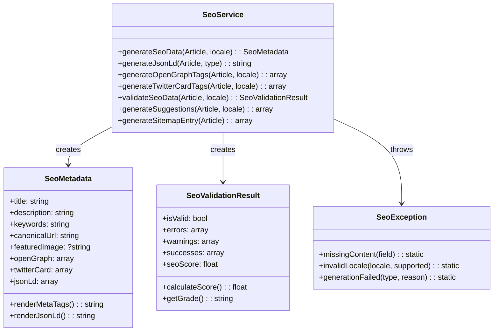

# SEO Service - Technical Guide

**Version:** 1.0.0
**Last Updated:** 2025-11-01
**Component:** Article Module (Task A7)

## Table of Contents

1. [Overview](#overview)
2. [Architecture](#architecture)
3. [Core Components](#core-components)
4. [SEO Metadata Generation](#seo-metadata-generation)
5. [Validation System](#validation-system)
6. [Configuration](#configuration)
7. [API Reference](#api-reference)
8. [Error Handling](#error-handling)
9. [Performance Considerations](#performance-considerations)
10. [Security](#security)

---

## Overview

The **SeoService** is a comprehensive SEO metadata generation system for "The Last Messenger" platform. It handles:

- **Schema.org JSON-LD** structured data
- **OpenGraph** meta tags for social sharing
- **Twitter Card** meta tags
- **Standard meta tags** (description, keywords, robots)
- **SEO validation** and scoring
- **Sitemap generation**
- **Multi-language support** (Arabic, English, French, Turkish, Urdu)

### Key Features

- ✅ Full Schema.org Article markup
- ✅ OpenGraph Protocol compliance
- ✅ Twitter Card integration
- ✅ Multi-language content support
- ✅ Automatic validation and scoring (0-100)
- ✅ SEO suggestions engine
- ✅ Sitemap XML generation
- ✅ XSS protection and sanitization
- ✅ RTL language support

---

## Architecture

### Service Layer Structure

```
app/Services/
├── SeoService.php                    # Main service class
├── Dtos/
│   ├── SeoMetadata.php              # Metadata container
│   └── SeoValidationResult.php      # Validation results
```

### Exception Hierarchy

```
app/Exceptions/
├── SeoException.php                  # Base exception
├── SeoValidationException.php        # Validation errors
└── SeoGenerationException.php        # Generation errors
```

### View Components

```
resources/views/components/
└── seo-meta-tags.blade.php          # Blade component for rendering
```

### Class Diagram



---

## Core Components

### 1. SeoService (Main Service)

**Location:** `app/Services/SeoService.php`

**Responsibilities:**
- Generate complete SEO metadata
- Validate SEO content
- Provide SEO improvement suggestions
- Generate sitemap entries
- Handle multi-language content

**Key Methods:**

#### generateSeoData()
```php
public function generateSeoData(Article $article, string $locale = 'ar'): SeoMetadata
```
Generates complete SEO metadata for an article in the specified language.

#### validateSeoData()
```php
public function validateSeoData(Article $article, string $locale = 'ar'): SeoValidationResult
```
Validates SEO content and returns a scored result with errors, warnings, and suggestions.

#### generateSuggestions()
```php
public function generateSuggestions(Article $article, string $locale = 'ar'): array
```
Analyzes article and provides actionable SEO improvement suggestions.

---

### 2. SeoMetadata (DTO)

**Location:** `app/Services/Dtos/SeoMetadata.php`

**Properties:**
```php
public string $title;                  // Page title (30-60 chars)
public string $description;            // Meta description (120-160 chars)
public string $keywords;               // Comma-separated keywords
public string $canonicalUrl;           // Canonical URL
public ?string $featuredImage;         // Featured image URL
public array $openGraph;               // OpenGraph tags
public array $twitterCard;             // Twitter Card tags
public array $jsonLd;                  // JSON-LD structured data
public array $metaTags;                // Additional meta tags
public string $locale;                 // Current locale
```

**Key Methods:**

#### renderMetaTags()
```php
public function renderMetaTags(): string
```
Renders all meta tags as HTML string for direct output in `<head>`.

#### renderJsonLd()
```php
public function renderJsonLd(): string
```
Renders JSON-LD as `<script>` tag for structured data.

---

### 3. SeoValidationResult (DTO)

**Location:** `app/Services/Dtos/SeoValidationResult.php`

**Properties:**
```php
public bool $isValid;                  // Overall validation status
public array $errors;                  // Critical issues
public array $warnings;                // Recommendations
public array $successes;               // Good practices
public float $seoScore;                // Score (0-100)
public array $metrics;                 // Detailed metrics
```

**Scoring System:**

| Score Range | Grade | Color  | Status          |
|-------------|-------|--------|-----------------|
| 90-100      | A     | Green  | Excellent       |
| 80-89       | B     | Green  | Good            |
| 70-79       | C     | Yellow | Acceptable      |
| 60-69       | D     | Orange | Needs Work      |
| 0-59        | F     | Red    | Poor            |

**Score Calculation:**
```
Base Score = 100
Each Error = -10 points
Each Warning = -5 points
Minimum Score = 0
Maximum Score = 100
```

---

## SEO Metadata Generation

### Schema.org JSON-LD

The service generates Schema.org Article markup:

```json
{
  "@context": "https://schema.org",
  "@type": "Article",
  "headline": "Article Title",
  "description": "Article excerpt",
  "image": "https://example.com/image.jpg",
  "author": {
    "@type": "Person",
    "name": "Author Name",
    "url": "https://example.com/author/1"
  },
  "publisher": {
    "@type": "Organization",
    "name": "The Last Messenger",
    "logo": {
      "@type": "ImageObject",
      "url": "https://thelastmessenger.com/logo.png"
    }
  },
  "datePublished": "2025-10-31T10:00:00Z",
  "dateModified": "2025-11-01T15:00:00Z",
  "mainEntityOfPage": {
    "@type": "WebPage",
    "@id": "https://thelastmessenger.com/articles/article-slug"
  }
}
```

### OpenGraph Tags

Generated OpenGraph tags for social sharing:

```html
<meta property="og:type" content="article">
<meta property="og:title" content="Article Title">
<meta property="og:description" content="Article description">
<meta property="og:url" content="https://thelastmessenger.com/articles/slug">
<meta property="og:locale" content="ar_SA">
<meta property="og:site_name" content="The Last Messenger">
<meta property="og:image" content="https://example.com/image.jpg">
<meta property="og:image:width" content="1200">
<meta property="og:image:height" content="630">
<meta property="article:published_time" content="2025-10-31T10:00:00Z">
<meta property="article:modified_time" content="2025-11-01T15:00:00Z">
<meta property="article:author" content="Author Name">
<meta property="article:section" content="Category Name">
<meta property="article:tag" content="tag1">
<meta property="article:tag" content="tag2">
```

### Twitter Card Tags

Generated Twitter Card tags:

```html
<meta name="twitter:card" content="summary_large_image">
<meta name="twitter:title" content="Article Title">
<meta name="twitter:description" content="Article description">
<meta name="twitter:image" content="https://example.com/image.jpg">
<meta name="twitter:image:alt" content="Article Title">
```

---

## Validation System

### Validation Rules

#### Title Validation
- **Minimum Length:** 30 characters
- **Maximum Length:** 60 characters
- **Optimal Length:** 55 characters
- **Checks:**
  - Length validation
  - Keyword presence (optional)
  - No keyword stuffing

#### Description Validation
- **Minimum Length:** 120 characters
- **Maximum Length:** 160 characters
- **Optimal Length:** 155 characters
- **Checks:**
  - Length validation
  - Keyword presence (optional)
  - Call-to-action presence (optional)

#### Keywords Validation
- **Minimum Count:** 3 keywords
- **Maximum Count:** 5 keywords
- **Checks:**
  - Keyword count
  - Keywords present in content
  - No keyword stuffing

#### Content Validation
- **Minimum Word Count:** 300 words
- **Checks:**
  - Sufficient content length
  - Heading structure (H1, H2, H3)
  - Internal links (3+ recommended)
  - External links (3-5 recommended)

#### Image Validation
- **Minimum Images:** 1 (featured image)
- **Optimal Dimensions:** 1200x630px (OpenGraph)
- **Checks:**
  - Featured image present
  - Image alt text present

### Validation Example

```php
use App\Services\SeoService;

$seoService = app(SeoService::class);
$validation = $seoService->validateSeoData($article, 'ar');

if ($validation->isValid) {
    echo "SEO Score: {$validation->seoScore}/100 (Grade: {$validation->getGrade()})";
} else {
    echo "Errors:\n";
    foreach ($validation->errors as $error) {
        echo "- $error\n";
    }
}

echo "\nWarnings:\n";
foreach ($validation->warnings as $warning) {
    echo "- $warning\n";
}
```

---

## Configuration

### SEO Settings

Configuration is defined in `SeoService::SEO_SETTINGS`:

```php
private const SEO_SETTINGS = [
    // Title constraints
    'title_min_length' => 30,
    'title_max_length' => 60,
    'title_optimal_length' => 55,

    // Description constraints
    'description_min_length' => 120,
    'description_max_length' => 160,
    'description_optimal_length' => 155,

    // Keywords constraints
    'keywords_min_count' => 3,
    'keywords_max_count' => 5,

    // Content constraints
    'min_content_length' => 300,
    'min_images' => 1,

    // Image dimensions
    'og_image_width' => 1200,
    'og_image_height' => 630,

    // Organization info
    'organization_name' => 'The Last Messenger',
    'organization_url' => 'https://thelastmessenger.com',
    'organization_logo' => 'https://thelastmessenger.com/logo.png',
];
```

### Supported Locales

```php
private const SUPPORTED_LOCALES = ['ar', 'en', 'fr', 'tr', 'ur'];
```

### Locale Mapping

```php
private const LOCALE_CODES = [
    'ar' => 'ar_SA',  // Arabic (Saudi Arabia)
    'en' => 'en_US',  // English (United States)
    'fr' => 'fr_FR',  // French (France)
    'tr' => 'tr_TR',  // Turkish (Turkey)
    'ur' => 'ur_PK',  // Urdu (Pakistan)
];
```

---

## API Reference

### SeoService Methods

#### generateSeoData()
```php
/**
 * Generate complete SEO metadata for article
 *
 * @param Article $article
 * @param string $locale Language code (default: 'ar')
 * @return SeoMetadata
 * @throws SeoException
 */
public function generateSeoData(Article $article, string $locale = 'ar'): SeoMetadata
```

**Example:**
```php
$seoService = app(SeoService::class);
$seo = $seoService->generateSeoData($article, 'ar');

// Use in view
return view('articles.show', compact('article', 'seo'));
```

---

#### generateJsonLd()
```php
/**
 * Generate Schema.org JSON-LD structured data
 *
 * @param Article $article
 * @param string $type Schema type (default: 'Article')
 * @return string JSON-LD string
 * @throws SeoGenerationException
 */
public function generateJsonLd(Article $article, string $type = 'Article'): string
```

**Example:**
```php
$jsonLd = $seoService->generateJsonLd($article);
echo $jsonLd; // Raw JSON string
```

---

#### validateSeoData()
```php
/**
 * Validate SEO data for article
 *
 * @param Article $article
 * @param string $locale Language code (default: 'ar')
 * @return SeoValidationResult
 */
public function validateSeoData(Article $article, string $locale = 'ar'): SeoValidationResult
```

**Example:**
```php
$validation = $seoService->validateSeoData($article, 'ar');

echo "Score: {$validation->seoScore}/100\n";
echo "Grade: {$validation->getGrade()}\n";
echo "Valid: " . ($validation->isValid ? 'Yes' : 'No') . "\n";
```

---

#### generateSuggestions()
```php
/**
 * Generate SEO improvement suggestions
 *
 * @param Article $article
 * @param string $locale Language code (default: 'ar')
 * @return array<string> Suggestions
 */
public function generateSuggestions(Article $article, string $locale = 'ar'): array
```

**Example:**
```php
$suggestions = $seoService->generateSuggestions($article, 'ar');

foreach ($suggestions as $suggestion) {
    echo "- $suggestion\n";
}
```

---

#### generateSitemapEntry()
```php
/**
 * Generate XML sitemap entry for article
 *
 * @param Article $article
 * @return array<string, mixed> Sitemap entry data
 * @throws SeoGenerationException
 */
public function generateSitemapEntry(Article $article): array
```

**Example:**
```php
$entry = $seoService->generateSitemapEntry($article);

// Output:
// [
//     'loc' => 'https://thelastmessenger.com/articles/slug',
//     'lastmod' => '2025-11-01T15:00:00Z',
//     'changefreq' => 'weekly',
//     'priority' => '0.9',
//     'images' => ['https://example.com/image.jpg']
// ]
```

---

## Error Handling

### Exception Hierarchy

```
SeoException (Base)
├── SeoValidationException
└── SeoGenerationException
```

### Exception Usage

```php
use App\Exceptions\SeoException;
use App\Exceptions\SeoValidationException;
use App\Exceptions\SeoGenerationException;

try {
    $seo = $seoService->generateSeoData($article, 'ar');
} catch (SeoValidationException $e) {
    // Handle validation errors
    Log::error('SEO validation failed', ['error' => $e->getMessage()]);
} catch (SeoGenerationException $e) {
    // Handle generation errors
    Log::error('SEO generation failed', ['error' => $e->getMessage()]);
} catch (SeoException $e) {
    // Handle general SEO errors
    Log::error('SEO error', ['error' => $e->getMessage()]);
}
```

---

## Performance Considerations

### Caching Strategy

**Recommended:** Cache generated SEO metadata for published articles.

```php
use Illuminate\Support\Facades\Cache;

$cacheKey = "article:{$article->id}:seo:{$locale}";

$seo = Cache::remember($cacheKey, now()->addHour(), function () use ($article, $locale) {
    return app(SeoService::class)->generateSeoData($article, $locale);
});
```

**Cache Invalidation:**
```php
// Invalidate on article update
Article::updated(function ($article) {
    foreach (['ar', 'en', 'fr', 'tr', 'ur'] as $locale) {
        Cache::forget("article:{$article->id}:seo:{$locale}");
    }
});
```

### Database Optimization

- Use **eager loading** for relationships: `$article->load('author', 'category', 'tags')`
- Index `slug`, `status`, and `published_at` columns
- Use **generated columns** for full-text search

---

## Security

### XSS Prevention

All user-generated content is sanitized:

```php
public function sanitizeText(string $text): string
{
    return htmlspecialchars($text, ENT_QUOTES, 'UTF-8');
}
```

### HTML Attribute Escaping

The `SeoMetadata::renderMetaTags()` method automatically escapes all attribute values:

```php
private function escapeAttribute(string $value): string
{
    return htmlspecialchars($value, ENT_QUOTES, 'UTF-8');
}
```

### Input Validation

- All locales are validated against whitelist
- URL formats are checked
- Image paths are validated before URL generation

---

## Best Practices

1. **Always generate SEO metadata** for published articles
2. **Cache metadata** to reduce database queries
3. **Validate before publishing** to ensure SEO compliance
4. **Use suggestions** to improve content quality
5. **Test social sharing** with OpenGraph debuggers
6. **Monitor SEO scores** in admin dashboard
7. **Regenerate metadata** when article is updated

---

## Related Documentation

- [SEO Service Integration Guide](./SEO_SERVICE_INTEGRATION.md)
- [SEO Service Usage Examples](./SEO_SERVICE_EXAMPLES.md)
- [SEO Service Quick Reference](./SEO_SERVICE_QUICK_REFERENCE.md)
- [Article Model Documentation](./ARTICLE_MODEL_GUIDE.md)

---

**End of Technical Guide**
