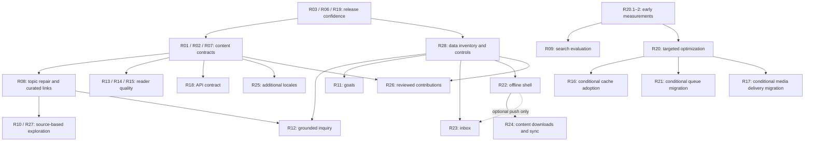

# Roadmap delivery plan — 13 September 2026

**Recommendation: complete the existing content and release workflows first, then expand reading and discovery. Adopt additional infrastructure only when measured results justify it.**

This is a rewritten plan for all **28 Auto-Claude roadmap features**, organized into **six delivery phases**. R01–R28 are stable planning references corresponding to the numbered features in the [original audit](/Volumes/Data/work/projects/the-last-massenger/dev/the-last-messenger/docs/ROADMAP-REVIEW-2026-09-13.md); they are not Auto-Claude database IDs. The exact original titles remain below so each proposal can be matched to its card.

The [action register](/Volumes/Data/work/projects/the-last-massenger/dev/the-last-messenger/docs/roadmap/action-register.csv) lists **205 numbered actions: 200 To do and 5 earlier implementation actions marked complete**. It includes phase, original task title, action status, and the source plan location. The Markdown task sections are authoritative; regenerate the register after changing them. Early repair/measurement slices retain their primary phase in the register and carry a sequence note.

Status: **proposed plan for review**. The user selected “fix verified defects and essentials first.” Later phases describe future work; their inclusion does not claim implementation, deployment, content approval, or infrastructure provisioning.

## What the independent review changes

1. **Hadith CRUD, public browsing, unified search, engagement metrics, account deletion, and synchronized audio already have substantial implementations.** Extend the actual gaps; budget and test against the current behavior.
2. **Topics has a concrete integration gap.** The service hardcodes an empty Hadith list; the current enum and morph registrations only include verses and articles. The unused Hadith mapper references obsolete fields. Repair this end to end early, before developing richer discovery.
3. **Deployment already has release directories, a symlink switch, a health probe, and rollback.** The script accepts a home-page redirect as healthy, has no bounded curl timeout, and immediately prunes previous releases after success. Strengthen these behaviors and prove recovery. Existing `/up` and `/api/v1/health` routes are starting points, not proof of dependency readiness.
4. **Account deletion already verifies the password, deletes tokens and the user, and removes avatars.** Data export is explicitly unavailable. Review all related records and retention, then extend the existing workflow.
5. **The Quran player is also being changed by another task.** Reconcile with the shared player and playlist work before touching synchronization. Re-running old UI expectations is not a substitute for understanding the current player.
6. **Redis and S3 configuration exist.** Database cache/queues are committed defaults; production configuration was not inspected. Elasticsearch, Redis, and CDN adoption each need a measurable benefit and an operational owner.
7. **Some generated requirements need revision.** Replace the fixed “901 tests,” mandatory DataTables, automatic file failover, blanket “no tracking,” and obsolete Lighthouse PWA score with observable behavior. All revisions are recorded in the relevant task.

Evidence was reviewed in the working tree based on commit `9342e00`, with additional uncommitted essential fixes and concurrent playlist edits. This is a dated snapshot, not a guarantee about later commits or production data.

## Plan navigation and phase gates

| Phase | Purpose and delivery order | Primary task count | Exit evidence |
|---|---|---:|---|
| [0 — Release confidence and user data](/Volumes/Data/work/projects/the-last-massenger/dev/the-last-messenger/docs/roadmap/phase-0-release-and-trust.md) | R03, R06, R05, R19, R28; start the measurement slice R20.1–R20.2 | 5 | Final revision passes gates; deployment recovery is rehearsed; mail is stage-checked; data inventory, export, and deletion coverage are verified |
| [1 — Complete content workflows](/Volumes/Data/work/projects/the-last-massenger/dev/the-last-messenger/docs/roadmap/phase-1-content-foundations.md) | R01, R02, R07, R04, R18; pull forward Topics repair R08.1–R08.3 | 5 | Reviewed content can be imported, edited, published, found, and documented without leaking hidden records |
| [2 — Quran reading quality](/Volumes/Data/work/projects/the-last-massenger/dev/the-last-messenger/docs/roadmap/phase-2-quran-reading.md) | R14, R15, R13 | 3 | Copy formats, playback behavior, and annotated rendering pass text-integrity and device checks |
| [3 — Connected knowledge and discovery](/Volumes/Data/work/projects/the-last-massenger/dev/the-last-messenger/docs/roadmap/phase-3-discovery.md) | R08 expansion, R09 evaluation, R10, R27, R12 | 5 | Curated links and provenance are visible; search meets an agreed evaluation; inquiry expansion passes grounding review |
| [4 — Measured performance and delivery](/Volumes/Data/work/projects/the-last-massenger/dev/the-last-messenger/docs/roadmap/phase-4-performance.md) | R20 optimization, then conditional R16, R21, R17 | 4 | Before/after load evidence, failure drills, reversible cutovers, and operating ownership for each adopted service |
| [5 — Engagement, offline use, and contribution](/Volumes/Data/work/projects/the-last-massenger/dev/the-last-messenger/docs/roadmap/phase-5-engagement-and-growth.md) | R11 and R25 can begin independently; R22 → R24; R23 inbox before optional push; R26 after content contracts | 6 | User controls, offline recovery, locale coverage, and editorial moderation meet the task checks |

Phases establish priority, not a rule to block every independent task. R20 measurement starts in Phase 0; performance fixes that address a demonstrated release problem can move forward. R08's broken Hadith integration is delivered in Phase 1 even though its broader feature belongs to Phase 3. Content acquisition and editorial review can begin before the associated UI phase. Conditional infrastructure can be declined without blocking PWA, email, search improvements, or community moderation.

## All 28 tasks and rewritten outcomes

**Done in Auto-Claude:** R03, R05, R06, as verified after the earlier status update. The other 25 remain Under Review. “Done” here records that app status and the earlier local implementation; staging and final-revision checks are listed separately. This planning pass does not change app statuses.

| ID | Original Auto-Claude title | Rewritten outcome | Phase | Assessment |
|---|---|---|---:|---|
| R01 | Hadith Admin Panel CRUD | Finish multilingual Hadith editing, narrator assignment, and bulk workflows | 1 | Extend existing |
| R02 | Hadith Public Site Browser | Complete a consistent, localized, publication-safe Hadith browser | 1 | Extend and validate |
| R03 | Fix Failing Tests and Test Gate | Maintain a reproducible test baseline and enforce it before deployment | 0 | Done; release checks remain |
| R04 | Dashboard Real Data Integration | Complete module metrics with truthful failure states and bounded query cost | 1 | Partial; core defects fixed |
| R05 | Bulk Operation Email Notifications | Validate opted-in completion mail through the real worker and transport | 0 | Done; staging check remains |
| R06 | Code Quality Baseline (Pint Lint Fix) | Keep formatting clean and mandatory in CI | 0 | Done; retain gate |
| R07 | Complete Quran Content Import Services | Prove approved edition coverage, safe reruns, and visible import progress | 1 | Extend and validate |
| R08 | Cross-Module Content Linking (Topics Enhancement) | Restore Hadith topics, then deliver curated related content across modules | 3 | Repair slice in Phase 1 |
| R09 | Elasticsearch-Powered Unified Search | Improve search relevance and latency; select the engine from evidence | 3 | Existing engine; migration conditional |
| R10 | Visual Hadith Narrator Chain Explorer | Render sourced narrator chains with accessible text and graph views | 3 | New UI on existing relations |
| R11 | User Engagement System (Streaks, Goals, Progress) | Extend current metrics with clear goals and optional motivation features | 5 | Extend existing |
| R12 | AI-Powered Inquiry Expansion | Add grounded Hadith retrieval and follow-ups within tested cost limits | 3 | Extend existing |
| R13 | Tajweed Color Coding for Quran Reader | Add verified Tajweed annotations without changing canonical verse text | 2 | New |
| R14 | Verse Copy/Share with Configurable Formats | Extend verse copying with exact formats, ranges, and honest delivery feedback | 2 | Extend existing |
| R15 | Audio-Text Synchronization for Quran Recitation | Complete and verify the existing shared playback state and timing coverage | 2 | Substantial existing work |
| R16 | Redis Caching Layer | Adopt Redis cache only where latency and invalidation tests justify it | 4 | Conditional infrastructure |
| R17 | CDN Integration (S3 + CloudFront) | Migrate eligible media through compatible storage and delivery adapters | 4 | Conditional infrastructure and migration |
| R18 | API Documentation (OpenAPI/Swagger) | Publish an accurate, tested contract for enabled API routes | 1 | Gap |
| R19 | CI/CD Pipeline Hardening | Strengthen existing quality gates, readiness checks, and release recovery | 0 | Extend existing deployment |
| R20 | Query Optimization and Database Performance | Establish repeatable query budgets and fix measured bottlenecks | 4 | Measurement starts Phase 0 |
| R21 | Queue Migration to Redis | Improve queue observability and isolate workloads; migrate if justified | 4 | Conditional driver change |
| R22 | Progressive Web App (PWA) | Deliver an installable shell with safe, versioned offline behavior | 5 | New |
| R23 | Real-Time Notifications System | Add durable subscriptions, preferences, and an inbox before live transport | 5 | New broader system |
| R24 | Offline Content Access | Deliver explicit content downloads, storage controls, and recoverable sync | 5 | New |
| R25 | Additional Language Support (Indonesian, Malay, Bengali) | Launch each new language only with reviewed UI and meaningful content coverage | 5 | Content and localization expansion |
| R26 | Community Contribution and Translation System | Add reviewed, attributable content suggestions with revision history | 5 | New editorial workflow |
| R27 | Interactive Seerah Map Experience | Present verified event geography and uncertain dates accurately | 3 | Extend location/timeline foundations |
| R28 | Privacy and Trust Dashboard | Add data export, verify deletion completeness, and explain actual data practices | 0 | Existing deletion; export gap |

## First implementation sequence

These are the next actionable units, not claims that this planning turn implemented them.

1. **R03.2 + R19.1:** record the final shared revision, resolve any remaining playlist boundary violations, and run the required isolated checks.
2. **R19.3–R19.5:** tighten the existing health probe, retain the previous release through an observation window, and rehearse rollback without reversing database migrations blindly.
3. **R05.2–R05.3:** stage-check opted-in completion/failure delivery, retry behavior, locale rendering, and the authenticated details link.
4. **R28.1–R28.2:** inventory user-linked data and exercise account deletion across records, tokens, files, jobs, and retained data.
5. **R20.1–R20.2:** capture representative data sizes, route/query baselines, and the 18/60-user load scenarios.
6. **R08.1–R08.3:** restore Hadith topic support through enum/morph registration, current record mapping, visibility, and regression coverage.
7. **R01.1–R01.3:** establish the Hadith translation and narrator editing contracts; preserve existing canonical identifiers.
8. **R07.1–R07.3:** build the Quran edition inventory and prove a small resumable/idempotent import before bulk content acquisition.
9. **R02.1–R02.4 + R04.1–R04.3:** close public-browser and dashboard gaps against those contracts.
10. **R28.3–R28.6 + R18.1–R18.5:** finish export and truthful privacy controls, then publish the API contract for the stable behavior.

Numbers order the work; the phase gates identify required completion evidence. Do not interpret this list as a ten-day schedule.

## Dependency map

An engine migration is not a prerequisite for Hadith retrieval. A queue driver migration is not a prerequisite for notifications. R26 can use the existing locales; R25 can use professional/editorial translations without waiting for community submissions.

## Delivery standards and measurable targets

Every task has numbered action items, prerequisites, acceptance checks, and rollout notes in its phase document. Unchecked boxes are future work; checked boxes identify earlier verified implementation only.

| Concern | Proposed completion evidence |
|---|---|
| Content correctness | Stable canonical references; edition/source attribution; approved records and localized fallback; no invented translations, grades, coordinates, or links |
| Public visibility | Hidden, unpublished, importing, deleted, and unavailable-locale fixtures excluded consistently from detail, list, count, search, related content, and downloadable data |
| User boundaries | Another user's export, progress, preferences, notification, or offline account data cannot be retrieved; logout/delete invalidation covered |
| Accessibility | Keyboard operation, focus handling, text alternatives, AR/RTL and LTR layouts, reduced-motion behavior where relevant; manual screen-reader checks on complex new interactions |
| Performance | Record environment, dataset, route mix, cache state, concurrency, duration, query counts, throughput, errors, and p50/p95/p99. Proposed HTTP p95: <200 ms at 18 virtual users and <500 ms at 60; these are targets, not measurements |
| Search | Proposed p95 <200 ms for the agreed server-side search endpoint and corpus; use a judged relevance set and report recall/ranking separately from speed |
| Availability | Explicit timeout/retry behavior, optional dependency degradation, and rehearsed recovery; target rollback within five minutes on the agreed compatible-release staging scenario |
| Queue operation | Measured enqueue-to-start time, retries and terminal failures by workload; proposed p95 <1 second for short priority jobs under the agreed load, separate from long import completion |
| CI | Tests, architecture, formatting, and introduced security/static-analysis gates pass on the delivered revision; track runtime toward <10 minutes without removing required checks |
| Runtime validation | Configured staging mail, production-like load and migration drills are distinct from unit/feature-test results |

Do not silently relax a missed target. Record the baseline, reason, remediation, and any proposed requirement change for review. Do not attach “all languages” or “all reciters” to an unknown inventory.

## Capacity, ownership, and review decisions

Task estimates are rough **engineering person-days**, covering implementation, relevant tests, and documentation after prerequisites are available. They exclude translation/content curation, procurement, production access delays, and major data cleanup. They are planning ranges, not delivery promises; re-estimate after the first bounded discovery action. Do not sum them into a fixed date without team capacity.

Each task names responsible roles. One implementation owner should be assigned to a task when it starts; an editor reviews religious content, and an operations owner reviews infrastructure cutovers. Keep shared-player changes coordinated with the existing playlist task.

Product/content decisions that affect later work:

- Which approved editions satisfy the 10 translations / 3 tafsirs / 5 reciters inventory, and who can verify their rights and coverage?
- Which locale completeness threshold permits launch? Proposed default: all navigation/account/security flows translated, plus a named content catalog whose missing translations are clearly labeled.
- Should quotas rise to 30 inquiries and 500 characters after the evaluation/cost gate? Proposed default: retain current limits until measured.
- Which environment and operating budget apply to Elasticsearch, Redis, object storage, and CDN? Proposed default: no cutover until the corresponding decision record is supported.
- Which contributed content can be published, under what attribution and reviewer policy? Proposed default: all public contributions require review.

These are decisions captured for review, not permission requests blocking the creation of this plan. See [architecture decisions and failure modes](/Volumes/Data/work/projects/the-last-massenger/dev/the-last-messenger/docs/roadmap/architecture-decisions.md).

## Verification history and limits

The earlier essential-fix verification recorded **1,251 tests passed, 0 failed, 1 skipped, 1 incomplete**, plus a clean Pint check. Deptrac had eight playlist boundary violations at that time. Those are historical results from the [audit](/Volumes/Data/work/projects/the-last-massenger/dev/the-last-messenger/docs/ROADMAP-REVIEW-2026-09-13.md), not a fresh test run on this planning pass.

This pass checks planning completeness and source references. It does not claim production inspection, new feature implementation, actual data imports, live mail delivery, or current performance compliance. The detailed plan supersedes the earlier audit's conclusions where additional source inspection found existing account deletion and deploy-script recovery.
